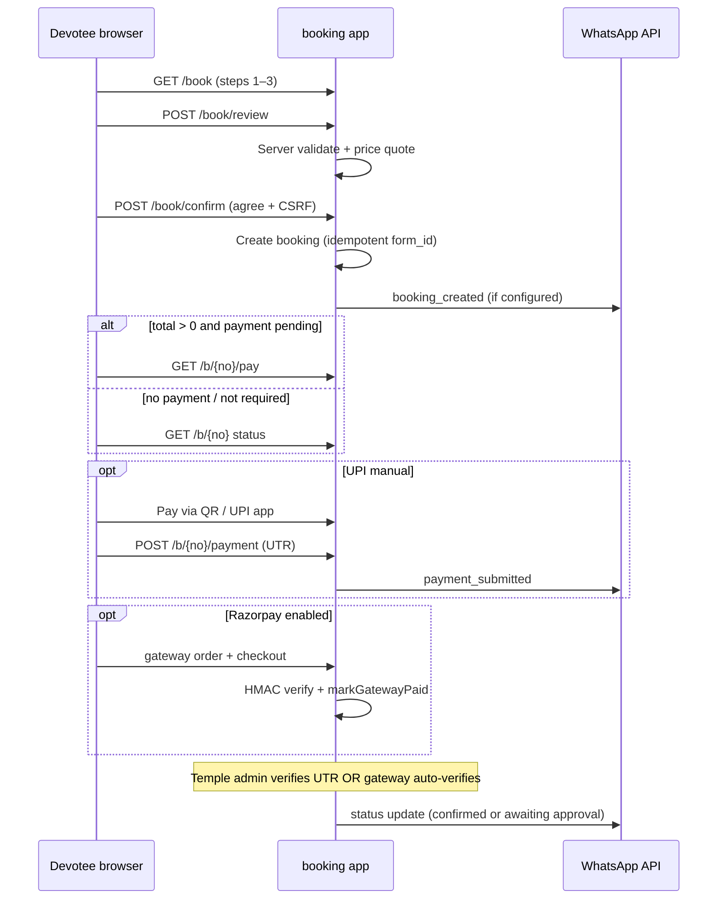

# Booking + ERP (`php/`) — end-to-end plan (no code yet)

This document describes **how booking works today**, **who must sign in**, **cancellation and books**, **payments already in the booking app**, and a **phased plan** to connect the public booking app to the temple ERP in [`../php/`](../php/) (cash book, day book, ledger, approvals).

Use it step-by-step: finish one phase (with tests) before starting the next.

Related: [`README.md`](README.md) (flows), [`docs/ADMIN-GUIDE.md`](docs/ADMIN-GUIDE.md), [`../php/README.md`](../php/README.md), [`../FEATURES.md`](../FEATURES.md).

---

## 1. Two systems today (important)

| | **Booking** `booking/` | **ERP** `php/` |
|---|---|---|
| Purpose | Public seva / prasadam booking, pay, invoice | Donations, expenses, inventory, **cash book**, ledger, bank recon |
| Database | Own DB (SQLite dev / MySQL prod) | `sjt_temple_blr` (separate) |
| Devotee access | No login | No login (except subscription pay link, coupon scan) |
| Staff access | `/Booking/admin` — booking admins table | `/php/` — `users` (Admin / Treasurer / Staff) |
| Money in books | **Not wired to ERP** — verified inside booking DB only | Donations post to cash/bank book; many actions need **approval** |
| Tests | `booking/tests/run.php`, `ui_test.py` | `php/tests/*_test.php` |

There is **no integration code** between them yet. This plan defines what to build.

---

## 2. Devotee (public user) — login and booking

### Is login required?

**No.** Devotees never create an account.

They identify themselves with:

- **Name, mobile (required), optional email** on the booking form.
- After submit: **booking number** (e.g. `SJT-2026-000123`) and a **private link** with `?t=<access_token>` (email/WhatsApp).
- Later access:
  - **Find my booking**: booking number + same mobile (must match exactly).
  - Or reuse the **private link** (or browser session after lookup).

Implementation: `Controller::accessibleBooking()` — token or session flag `bk[booking_no]`.

### End-to-end devotee journey (current booking app)

**Confirmed booking** (devotee-facing) only when:

- Payment is **paid** or **not_required**, **and**
- Ceremony **approval** is **approved** or **not_required** (`Status::derive()`).

Until then the UI says **request received**, not confirmed.

### What devotees cannot do today

- **Self-cancel** online (documented in `TEMPLE-ACTION-ITEMS.md`). They contact the office.
- **Edit** a submitted booking (admin reschedule / cancel only).
- See ERP cash book or receipt `RCPT-*` unless you add that in a later phase.

---

## 3. Temple roles — booking admin vs ERP

### Booking app (`/Booking/admin`)

| Role | In code | Typical use |
|---|---|---|
| **staff** | `admins.role = staff` | Verify UTR, approve ceremonies, cancel, reschedule, notes |
| **super** | `admins.role = super` | Above + services, prices, coupons, slots, UPI settings, users |

Routes: most booking actions need `admin`; catalog/settings need `super` (`routes.php` + `Kernel.php`).

**Separate login** from ERP — different username/password table.

### ERP (`php/`)

| Role | Approval power |
|---|---|
| **Staff** | Prepare expenses, contra, etc.; limit configurable (often ₹0 approve) |
| **Treasurer** | Approve up to limit (default ₹10,000) |
| **Admin** | Unlimited approve; users module |

**Donations** when entered in ERP generally **post to cash book immediately** (no approval queue). **Expenses, contra, opening balance, receipt cancellation, donation edits, large stock/coupon batches** use the **`approvals`** table (`Waiting` → `Approved` before books change).

### Recommended operational mapping (policy, not code)

| Action | Booking app | ERP (after integration) |
|---|---|---|
| Devotee pays UPI + UTR | Staff verifies in booking | Phase 3: create/link **donation** with same UTR |
| Counter cash for booking | Admin “record payment” in booking | Phase 3: donation **Cash** |
| Cancel unpaid booking | Booking cancel only | No ERP line (nothing was booked in ERP) |
| Cancel paid booking | Cancel + **refund** in booking | Phase 4: **correction** or **receipt cancel** with approval |
| Shraddha / marriage approval | Booking `approve` / `reject` | Optional Phase 5: mirror as ERP note only, or skip duplicate approval |

---

## 4. Cancellation and journal books (current vs target)

### Today — booking only

1. Admin opens booking → **Cancel** → **reason required** → devotee notified (`BookingService::cancel`).
2. Slot capacity freed; `booking_status = cancelled`.
3. If **already paid**: admin records **refund** (reference + note) → `payment_status = refunded`.
4. **ERP cash book / day book / ledger**: unchanged (booking money never entered ERP).

Audit: booking `audit_log` + history on booking page.

### Today — ERP journal behaviour (for later sync)

- **Cash book / day book / ledger**: updated when a donation/expense line is **Approved** (or immediately for a new donation).
- **Cancel receipt**: receipt number kept; status cancelled **after approval**; money **stays in books** until a controlled reversal (`FEATURES.md` — corrections / cancellation workflow).
- **Correction**: original line kept; adjustment line after approval.

### Target behaviour (integrated)

| Event | Booking DB | ERP books |
|---|---|---|
| Payment verified | `payment_status = paid` | **Create donation** (purpose = seva type), UPI ref, link `external_ref = booking_no` |
| Booking cancelled, never paid | `cancelled` | No donation; no ERP action |
| Booking cancelled, was paid | `cancelled` + `refunded` | **Draft reversal** (correction or receipt cancel) → Treasurer/Admin **approval** → then cash book updated |
| Payment verified then rejected (UTR wrong) | `failed`; devotee resubmits | No donation until re-verified; if donation was already posted, Phase 4 reversal rules |

**Principle:** ERP remains source of truth for **cash/bank/ledger**; booking remains source of truth for **slots, seva schedule, devotee comms**. Sync on **verified money** and **approved reversals** only.

---

## 5. Payments in the booking app (what exists)

| Method | Config | Devotee experience | Marked paid when |
|---|---|---|---|
| **UPI dynamic QR** | `upi_vpa`, `upi_verified` tick | Per-booking amount + booking no in URI | Admin **verifyPayment** against bank |
| **UPI static QR** | Upload temple QR | Devotee types amount; booking no in remark | Admin verify |
| **UTR submit** | Always (if amount due) | Form on pay page | **Never** auto — `awaiting_verification` only |
| **Razorpay** | `PAYMENT_GATEWAY=razorpay` + keys | Checkout on pay page | Server **HMAC** (`gatewayVerify` + webhook `payment.captured`) |

Optional: gateway amount mismatch → stays `awaiting_verification` for manual review (`markGatewayPaid`).

**Preview HTML** (`bookingPreview.html`) mimics UPI + UTR only; Razorpay is live-app only.

Bank reconciliation in ERP already matches donations by **UPI reference** (90 days) or amount+date — Phase 3 should use the **same UTR** on the donation row for auto-match.

---

## 6. ERP integration design (conceptual)

### 6.1 Identifier bridge

Store on ERP side (new columns or side table — decide in Phase 2):

- `booking_no`, `booking_invoice_no` (SJTB/…)
- `booking_app_payment_id` / gateway id
- Idempotency: one donation per verified payment (retry-safe)

Store on booking side (Phase 2):

- `erp_donation_id`, `erp_sync_status`, `erp_last_error`

### 6.2 Donor match

ERP `donors` matched by **normalised mobile** (same rules as booking). Create donor if missing (policy: auto-create vs staff review queue).

### 6.3 Purpose / ledger head mapping

Booking services → ERP `puja_purposes` / donation `purpose` (`php/storage/selections.json`):

- Maintain a **mapping table** (admin UI Phase 2): e.g. `Special Puja` → `Special Puja` purpose head.
- Food coupon lines: either one combined purpose or split (align with temple accountant).

### 6.4 Integration style (choose one in Phase 2 kickoff)

| Option | Pros | Cons |
|---|---|---|
| **A. HTTP API** (booking → ERP internal endpoint) | Clear boundary, testable | Need auth, deploy both |
| **B. Shared MySQL** (read/write ERP tables from booking) | Fewer moving parts | Coupling, harder to host separately |
| **C. Outbox + cron** (booking writes `sync_queue`, ERP worker) | Resilient, retries | Slight delay |

**Recommendation:** **C or A** for production; **B** only if both apps share one server and one DB user with strict stored procedures.

### 6.5 Approval for ERP posting

Suggested policy:

- **Verify payment in booking** = operational truth for seva.
- **Post donation to ERP** automatically when booking payment → **paid** (same as manual donation entry), **if** amount ≤ Treasurer limit.
- Above limit: create donation in **Waiting** approval in ERP (extend `approvals.subject_type` e.g. `booking_sync`) — *Phase 4 optional*.

Cancellations/refunds: always **ERP approval** (mirror receipt cancellation / correction).

---

## 7. Phased implementation (with tests)

Each phase: **definition of done**, **tests**, **rollback**.

### Phase 0 — Align catalog and ops (no integration)

| Task | Done when |
|---|---|
| Temple confirms prices, slots, UPI, WhatsApp templates | `TEMPLE-ACTION-ITEMS.md` signed off |
| Map each booking service name to ERP puja purpose (spreadsheet) | Mapping doc approved by treasurer |
| Run booking standalone on staging | `tests/run.php` PASS; `TESTING.md` checklist |
| Train staff on booking admin only | ADMIN-GUIDE walkthrough |

**Tests:** existing `run.php` + manual UAT from `docs/TESTING.md`.

---

### Phase 1 — Booking live without ERP

Deploy `booking/` to `/Booking`. ERP continues as today.

**Done when:** real bookings + manual ERP donation (staff copies booking no / UTR into donation form).

**Tests:** Phase 0 + production smoke (health, one ₹1 UPI test).

---

### Phase 2 — Read-only link ERP ↔ booking

| Task | Done when |
|---|---|
| ERP: new screen or donation note field “Booking no” (search only) | Staff can open booking status URL from ERP |
| Booking admin: show “ERP donation” link if synced | Visible when `erp_donation_id` set |
| Schema/migration for bridge fields | Documented |

**Tests:**

- `php/tests/` — new test: lookup by booking ref field (read-only).
- Booking — unit test: bridge fields nullable.

**No automatic posting yet.**

---

### Phase 3 — Post to ERP when payment verified

Trigger: `BookingService::verifyPayment` and `markGatewayPaid` (payment_status → paid).

| Task | Done when |
|---|---|
| Sync worker creates **donation** + receipt optional policy | One row in `donations`; appears in cash book |
| UPI ref copied to `donations.upi_reference` | Bank recon can match |
| Idempotent: second verify does not duplicate | Test with same booking |
| Failure queue visible to admin | Retry button or log |

**Tests:**

- Booking: extend `run.php` case “verify → sync mocked ERP” (HTTP mock or test double).
- ERP: new `booking_sync_test.php` — donation created with correct amount, mode UPI, purpose mapping.
- Manual: verify booking → see line in **day book** same date.

**Out of scope for Phase 3:** cancel reversal (Phase 4).

---

### Phase 4 — Cancel, refund, journal reversal

Trigger: `cancel` + `refund` on paid bookings (and optionally `reject` after sync).

| Task | Done when |
|---|---|
| ERP: reversal proposal (correction or cancel receipt flow) | Status **Waiting** in approvals |
| Treasurer/Admin approves → cash book / ledger updated | Matches `approval_test.php` patterns |
| Booking `erp_sync_status = reversed` | Audit trail both sides |

**Tests:**

- Booking `run.php`: cancel paid booking → sync calls reversal API once.
- ERP `corrections_test.php` / `approval_test.php`: extended for booking-linked reversal.
- Scenario: verify → post → cancel → approve reversal → net zero in ledger head.

---

### Phase 5 — Ceremony approval and staff workflows (optional polish)

| Task | Done when |
|---|---|
| Dashboard tile in ERP: “Bookings awaiting approval” (API poll) | Or deep link to booking admin |
| Food-only bookings: optional ERP coupon batch link | Policy decision |
| Single sign-on | Only if temple wants one login (large scope) |

**Tests:** UI smoke; role matrix (staff cannot change ERP mapping).

---

### Phase 6 — Razorpay production + recon

| Task | Done when |
|---|---|
| Razorpay live keys + webhook URL | `WebhookController::razorpay` |
| Gateway payment creates same ERP donation path as manual verify | Phase 3 handler reused |
| ERP bank CSV matches Razorpay settlement refs | Reconciliation doc |

**Tests:** Razorpay test mode in staging (`CONFIGURATION.md`); webhook signature test.

---

## 8. Test matrix (by actor)

| Actor | Phase 1 | Phase 3 | Phase 4 |
|---|---|---|---|
| **Devotee** | Book, pay UTR, lookup | Same + donation appears on receipt request | Cancel via office; books correct after approval |
| **Booking staff** | Verify, approve seva, cancel | Verify triggers sync | Refund + ERP reversal queue |
| **ERP Treasurer** | Manual donation backup | Approve large sync if enabled | Approve reversal |
| **ERP Admin** | Users, purposes | Mapping maintenance | Audit both systems |

Automated:

- **Booking:** `cd booking && php tests/run.php`
- **ERP:** `php php/tests/books_test.php`, `approval_test.php`, plus new sync tests per phase
- **Browser:** `booking/tests/ui_test.py` for wizard; ERP manual for cash book view

---

## 9. Decisions needed before Phase 2 coding

1. **Integration style:** API vs outbox vs shared DB?
2. **Auto-post donation on verify** or **always Waiting** in ERP?
3. **Receipt PDF:** generate ERP `RCPT-*` on sync, or keep booking invoice as official seva receipt?
4. **Food coupons:** separate ERP lines per coupon category?
5. **One MySQL server:** merge DBs vs keep separate with sync?
6. **Devotee cancel:** stay office-only or add “request cancellation” (no auto reverse)?

---

## 10. Summary answers (FAQ)

| Question | Answer today |
|---|---|
| Must devotee login? | **No** — mobile + booking no or private link |
| Must staff login for booking? | **Yes** — booking admin |
| Must staff login for ERP books? | **Yes** — `php/` users |
| How cancel? | **Admin only** in booking; reason; refund if paid; **ERP reversal in Phase 4** |
| QR vs Razorpay? | Both supported in code; UPI needs admin verify unless Razorpay enabled |
| Journal updated? | **Not yet** — booking is isolated; plan Phase 3–4 for cash book / ledger |

---

*Next step:* review Section 9 decisions, then start **Phase 0** checklist. When approved, implement **Phase 2** schema + read-only links before any money sync.
