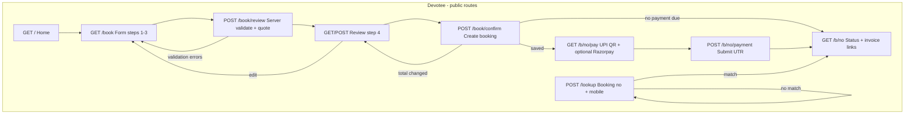
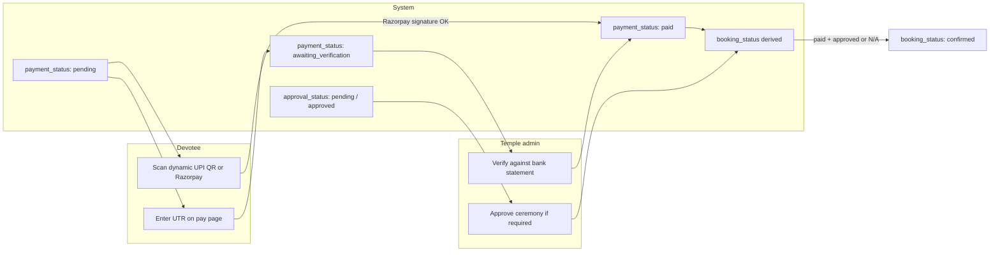
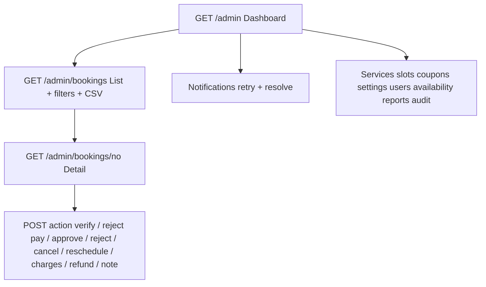
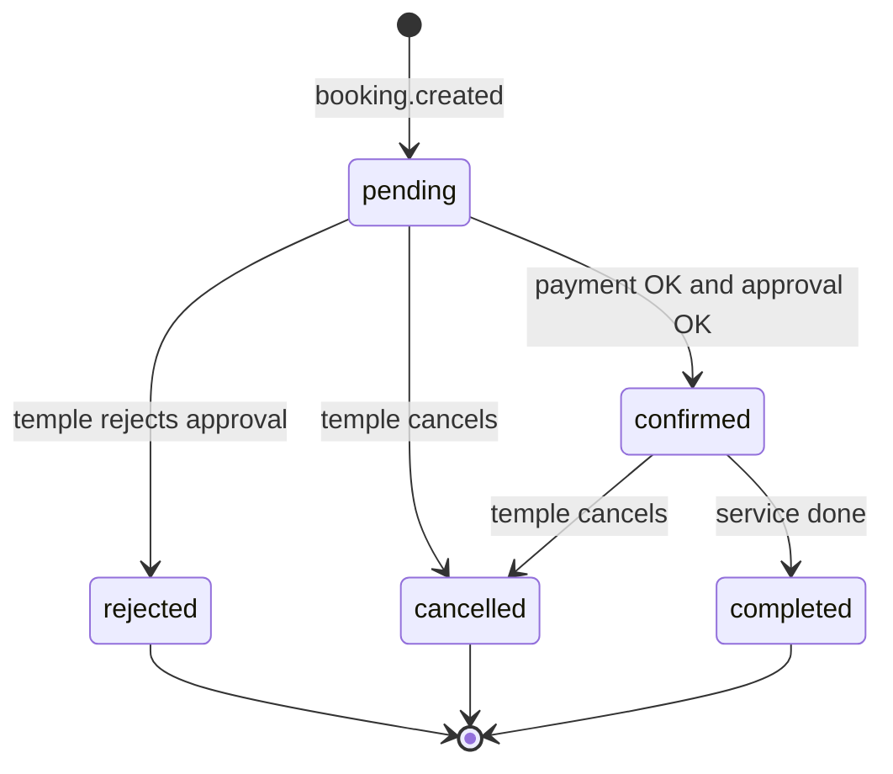

# Temple online booking — flow & gap review

This folder **is** the production booking application (`app/`, `assets/`, `storage/`, …). At the repo root, **`bookingPreview.html`** is a standalone UI prototype with sample data (nothing is saved to a database).

| Artifact | Role |
|---|---|
| [`../bookingPreview.html`](../bookingPreview.html) | Design / UX preview for stakeholders; jump-bar between screens; WhatsApp opens via `wa.me` links |
| **`booking/`** (this folder) | PHP 8.1+ app: persistence, pricing, payments, admin, PDF invoices, WhatsApp Cloud API |

Full feature list: [`docs/SYSTEM-OVERVIEW.md`](docs/SYSTEM-OVERVIEW.md). Pre-launch checklist: [`docs/TEMPLE-ACTION-ITEMS.md`](docs/TEMPLE-ACTION-ITEMS.md). Hosting: [`docs/DEPLOYMENT-CPANEL.md`](docs/DEPLOYMENT-CPANEL.md).

**Step-by-step booking + ERP (`php/`) integration plan (roles, cancel, payments, phased tests):** [`ERP-INTEGRATION-PLAN.md`](ERP-INTEGRATION-PLAN.md).

### Same MySQL database as ERP (recommended here)

Use one database (e.g. **`sjt_temple_blr`**) for both apps. Point booking `.env` at the **same** `DB_NAME`, `DB_USER`, and `DB_PASS` as `php/.env` / `php/config.php`.

1. ERP tables already exist from `php/install.php` or first visit.
2. From this **`booking/`** folder: copy `.env.example` → `.env`, set `APP_KEY` and `INSTALL_TOKEN`, then either:
   - **Browser:** open `https://your-site/Booking/install.php`, or
   - **SSH:** `php bin/console.php migrate` and `php bin/console.php create-admin …`
3. After web setup: delete `install.php` and remove `INSTALL_TOKEN` from `.env`.
4. Booking adds its own tables (`bookings`, `services`, `admins`, `booking_coupons`, …) and `schema_migrations`. It does **not** replace ERP `users` or ERP `food_coupons` (serial codes). Prasadam **catalog** for online booking lives in **`booking_coupons`**.

Logins stay separate: ERP `users` vs booking `admins`.

---

## Devotee booking flow (live app)

The live system matches the preview’s **six progress steps** (Choose service → Details → Prasadam → Review → Pay → Done), but steps 1–3 are one form (`POST /book/review`), step 4 is server-rendered review (`POST /book/confirm`), and pay/status use booking URLs with an access token.

**After submit:** the devotee gets a booking number immediately. That is a **booking request**, not a confirmed seva, until payment (if any) is **verified** and, for approval-required services, the temple **approves**.

---

## Payment & confirmation flow

Preview uses three payment labels (`pending` → `awaiting` → `paid`). The live app uses **`awaiting_verification`**, separate **approval** status, and never marks paid from UTR alone.

| State | Preview (`bookingPreview.html`) | Live (`booking/`) |
|---|---|---|
| UTR submitted | Sets `payment = awaiting` | `payment_status = awaiting_verification`; row in `payments` |
| Mark paid | Admin button flips to `paid` | `verifyPayment()`; audit log + WhatsApp |
| Needs approval | `status` stays `pending` after pay | `approval_status` + `Status::derive()` |
| Confirmed | When paid and no approval service | When paid/not_required **and** approved/not_required |

---

## Admin flow (live vs preview)

Preview shows a **mock dashboard** (fixed counts) and a simplified booking screen (verify payment only; reschedule/cancel/note are empty shells).

Implemented in live admin but **not** interactive in the preview: reject payment, adjust “Other services” charges, approve/reject ceremony, reschedule with capacity check, refund, notification retry, CSV export, availability blocks, full audit trail.

---

## Booking status state machine (live)

Headlines shown to devotees are centralized in `Status::headline()` (payment pending, awaiting verification, awaiting approval, confirmed, etc.).

---

## Preview vs production — alignment

| Area | Preview | Live app | Notes |
|---|---|---|---|
| Step wizard UI | Single HTML file, client-only | `form.php` + JS; works without JS (all steps visible) | Same step names and temple palette |
| Services & prices | Hard-coded in JS | Database + admin CRUD | Preview ₹501/₹251…; live defaults are placeholders until temple confirms |
| Food coupons | 4 items in JS | Configurable in admin | Preview “Extra Kheeri”; live may differ by seed data |
| Availability / capacity | Hint text only | `GET /api/availability` + locks on submit | Preview does not call API |
| Review & pricing | Client `total()` | Server `BookingForm::validate()` at review **and** confirm | Live detects price changes mid-session |
| Submit | Instant fake booking no | DB transaction, idempotency key, rate limits | Preview: “Bookings are not saved” |
| Booking link | N/A | `/b/{no}?t={access_token}` | Required for pay/invoice without lookup |
| Lookup | Always succeeds with sample | Booking no + mobile must match | Live uses `hash_equals` on mobile |
| WhatsApp | Opt-in checkbox + manual `wa.me` | Cloud API auto-send; logged failures | Preview admin WA stored in `localStorage` only |
| Invoice PDF | Button label only | `invoice.pdf` via `app/Lib/PdfDocument.php` (zero-dependency) | |
| Razorpay | Not shown | Optional gateway + webhook | See `TEMPLE-ACTION-ITEMS` optional item |
| Terms / privacy | Checkbox only | Settings `terms_text` on review | |
| Email | Field present, optional | Validated optional email | |
| Service rules | Food-only vs others in JS | `is_combinable`, `is_food_only` server rules | |

---

## What is missing or not wired yet

### Relative to `bookingPreview.html` (prototype gaps)

These are **intentionally stubbed** in the preview; the live app already covers most of them:

1. **Real persistence and idempotent submit** — preview only; live has it.
2. **Separate approval badge and workflow** — preview collapses into one “Confirmed / Request received” badge; live exposes payment + approval + booking status.
3. **Payment reject / failed path** — not simulated in preview; live notifies devotee to resubmit UTR.
4. **Admin reschedule, cancel, notes, refunds** — preview UI placeholders; live forms on `/admin/bookings/{no}`.
5. **Dynamic availability** — preview static; live API + admin calendar.

### Relative to going live (temple / ops — see action items doc)

1. **Hosting** — app targets `https://sjtbengaluru.org/Booking`; not linked from this AMPPS `php/` inventory repo by default.
2. **UPI VPA** — preview uses `shreejagannathtrust@rbl` (real QR in demo bar); production must be treasurer-approved and ₹1-tested.
3. **WhatsApp Business Cloud API** — templates, phone number, token; until then messages queue as failed (bookings still work).
4. **Final service prices, slots, capacities, closure dates** — seed data is editable but not committee-signed-off.
5. **Temple contact block on invoices** — preview shows “(temple office number)”; live reads settings (must be filled).
6. **Optional Razorpay** — for automatic pay confirmation without manual UTR check.
7. **Integration with main site** — root [`README.md`](../README.md) documents inventory/donation `php/` app only; add navigation or embed when Booking is deployed.

### Relative to this monorepo layout

| Gap | Detail |
|---|---|
| `bookingPreview.html` location | Sits at repo root; not served from `booking/` — useful for static demos only |
| Two products | Inventory (`php/`) vs booking (`booking/`) — can share one MySQL database; separate admin logins |
| No shared README at booking level before | This file documents cross-artifact flows |

---

## Quick reference — key files

| Concern | Location |
|---|---|
| Routes | `app/routes.php` |
| Wizard submit | `app/Controller/BookingController.php` |
| Pay / lookup / invoice | `app/Controller/PublicController.php` |
| Business rules & pay verify | `app/Service/BookingService.php` |
| Status rules | `app/Service/Status.php` |
| UI prototype | `../bookingPreview.html` |

---

## Suggested next steps

1. Walk stakeholders through **`bookingPreview.html`** (jump bar) for UX sign-off.
2. Run **`booking/`** on staging per [`docs/DEPLOYMENT-CPANEL.md`](docs/DEPLOYMENT-CPANEL.md) and complete [`docs/TESTING.md`](docs/TESTING.md).
3. Close items in [`docs/TEMPLE-ACTION-ITEMS.md`](docs/TEMPLE-ACTION-ITEMS.md).
4. Add a “Book seva / prasadam” link on the public temple site pointing to `/Booking` once deployed.
