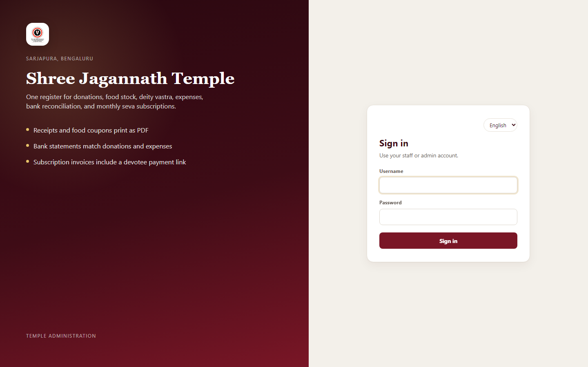
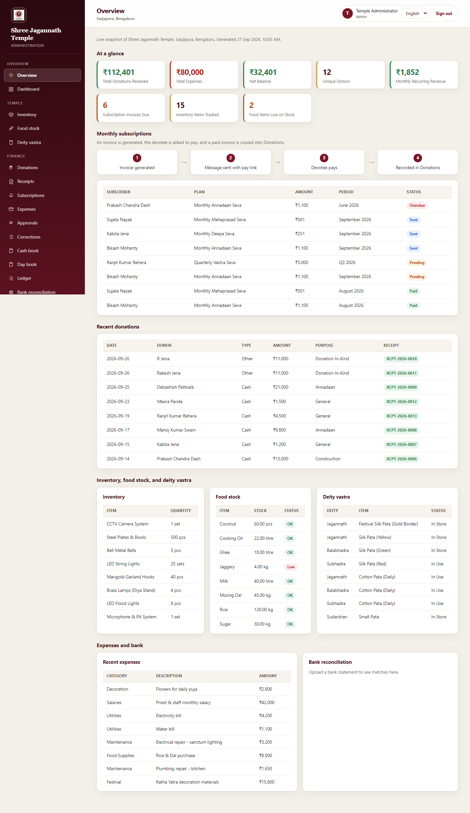
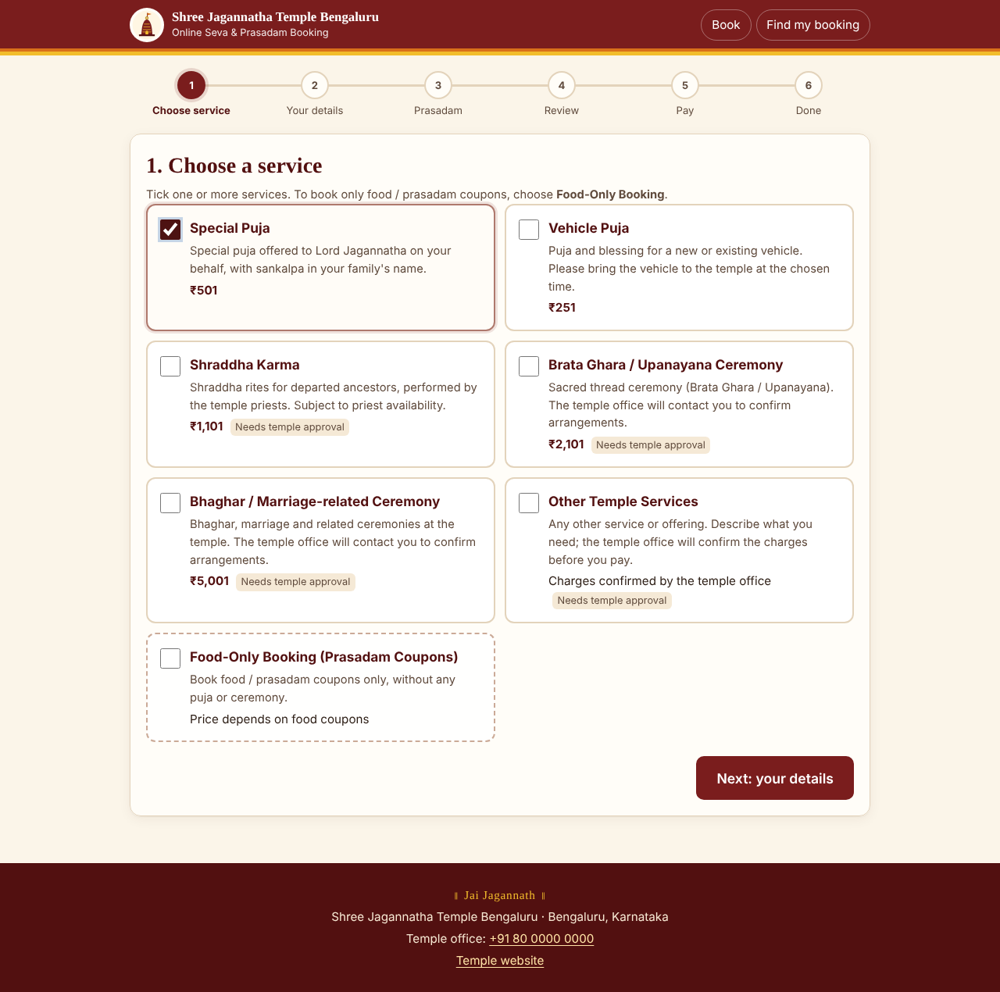

# Temple ERP & Online Booking

**Open-source temple management** for day-to-day administration, finance, inventory, and **devotee-facing online booking** - puja services, prasadam coupons, payments, and staff approvals in one place.

Built as a **seva (service) contribution** for spiritual work: to help temple offices run registers honestly, keep books in order, and let devotees book sevas with clarity - offered with devotion, for use by any temple community that shares similar needs.

Originally developed for **Shree Jagannath Temple, Sarjapura, Bengaluru**; the codebase is structured so other temples can adopt, configure, and extend it.

---

## At a glance

| Application | Folder | Stack | Role |
|---|---|---|---|
| **Temple ERP** | [`crm/`](crm/README.md) | PHP 8.1+, MySQL | Staff sign-in: donations, books, inventory, coupons, approvals, reports |
| **Online booking** | [`Booking/`](Booking/README.md) | PHP 8.1+, MySQL | Public site: book services & prasadam, pay, track status |
| Prototype (Flask) | [`python/`](python/README.md) | Flask, SQLite | Local reference app |

Both **ERP** and **Booking** can share one MySQL database (e.g. `sjt_temple_blr`): one set of staff users, unified catalog pricing, and donations that flow into the cash book, day book, and ledger when payments are verified.

---

## Screenshots

### Sign in (ERP)

Staff and treasurers sign in once for registers, finance, and (when integrated) booking admin.



### ERP dashboard & registers

End-to-end temple back office: gifts, expenses, stock, coupons, subscriptions, bank match, and printable reports - with role-based approvals before sensitive lines hit the books.



### Online booking (devotee)

Mobile-friendly flow: choose services, enter details, add prasadam coupons, review pricing, pay (UPI QR / gateway), and receive status updates.



More UI captures: [`docs/images/`](docs/images/) (ERP user guide) and [`Booking/docs/screenshots/`](Booking/docs/screenshots/) (responsive booking flow).

---

## Why this helps temples end to end

1. **Front desk & counter** - Record cash and in-kind donations, print receipt PDFs, issue food coupons, manage inventory and kitchen stock, track deity vastra.
2. **Finance & compliance** - Cash book (April-March), day book, ledger by purpose/category, expense vouchers, corrections, and bank reconciliation against uploaded statements.
3. **Governance** - Treasurer and Admin approval chains for expenses, large batches, stock write-offs, donation edits, and receipt cancellations; preparer cannot approve their own item.
4. **Devotee outreach** - Recurring seva subscriptions with invoice and pay links; invitation designs; optional localization (English / Hindi / Odia labels).
5. **Online channel** - Devotees book ceremonies and prasadam online; staff verify payments and approve services where required; confirmed bookings can post into ERP donations and **update the books automatically** when integrated.

You get one coherent story from **counter coupon** → **sold coupon in cash book** → **ledger balance**, and from **online booking paid** → **donation + receipt** → **same ledger heads** - without duplicate spreadsheets.

---

## Customize from Settings (no code changes)

Most temple-specific behavior is edited in the **ERP admin UI** by an **Admin** (some catalog changes also allow **Treasurer**). You do not redeploy PHP or edit source files for day-to-day changes. Devotee names, amounts, and historical receipts stay as entered; new rules apply to **new** bookings and forms going forward.

### Where to go

| Area | Menu | What you control |
|---|---|---|
| **Settings hub** | Administration → **Settings** | Identity, approvals, mail, ERP form lists, online booking catalog (when integrated) |
| **Localization** | Administration → **Localization** | On-screen labels for staff (and the sign-in language switch) |
| **Booking operations** | **Booking** admin (or ERP shortcuts) | Verify payments, approvals, day-to-day booking actions (catalog/prices stay in Settings) |

See [`docs/USER-GUIDE.md`](docs/USER-GUIDE.md) (Settings and Localization chapters) and [`Booking/docs/CONFIGURATION.md`](Booking/docs/CONFIGURATION.md) for step-by-step hosting setup.

### Temple identity, books, and approvals

Under **Settings → Name, place, and logo**: temple name and location on screen, receipts, coupons, sign-in, and email signatures; logo upload; watermark strength on PDF receipts and coupons.

Under **Settings → Approval limits**: how much a **Staff** or **Treasurer** may approve before an **Admin** must decide (expenses, coupon batches, stock write-offs, and similar queues).

### Form choices (ERP dropdowns and lists)

Under **Settings → Form choices**, add, rename, or remove entries in the lists that drive ERP forms, without touching code:

- **Shared lists** (used in many modules): payment modes, units, sources, deities  
- **Module lists**: inventory categories, expense categories, item condition, stock movement types, vastra status, donation types, **donation purposes** (ledger heads), subscription plans, billing cycles, subscriber statuses  

Each list is maintained in a table on the Settings page: type a label, save, and the next donation, expense, inventory, or subscription form offers the updated options. Duplicates in one list are blocked. Puja/prasadam **names and prices for the public booking site and printed coupons** are managed under **Settings → Online booking → Catalog & pricing**, not under the legacy puja-purpose list.

### Outgoing email (SMTP)

Under **Settings → Messages**, configure the **SMTP server** (host, port, encryption, from name, from email, username, password). The password is stored securely and is not shown again after save.

When mail is ready, the ERP can send **subscription invoices**, **receipt emails**, and other notifications that use the same server. The **Booking** app reads this configuration from the shared database when both apps use one MySQL database, so one mail setup serves ERP and booking mail paths.

WhatsApp on invoices and receipts opens **WhatsApp Web** with a template message from Settings (no Meta API required for that shortcut).

### Languages and localization

Supported UI languages today: **English**, **Hindi**, and **Odia** (see `crm/locales/languages.json`).

- **Sign-in**: users can switch language on the login card; menus and buttons follow the chosen locale.  
- **Localization** (Admin): pick a language, search or browse phrases (menu labels, headings, buttons), edit the text, and save. Devotee names, rupee amounts, receipt numbers, and saved Settings choices are **not** translated automatically. They remain exactly as staff typed them.

Adding a **new** language still requires locale files in the repo; changing **wording** for an existing language does not.

### Online services and dynamic booking forms

Under **Settings → Online booking** (visible when Booking shares the same database), the temple configures what devotees see on the public site:

| Topic | Configure in Settings |
|---|---|
| **Services** | Add or edit puja/ceremony cards: name, price, description, enable/disable online |
| **Rules per service** | Requires staff approval; must pick a time slot; ask participant count; allow food add-on; combinable with other services; daily cap; minimum lead days |
| **Extra fields (dynamic form)** | Per service, add questions devotees must answer: short text, long text, number, date, or **choice list** (comma-separated options); mark required or optional |
| **Time slots** | Labels, capacity, and weekdays per service |
| **Prasadam menu** | Coupon categories for online food/prasadam: name, price per person, max per booking, sort order, on/off |
| **Dates & capacity** | Closed dates (festivals/maintenance); booking window (minimum notice, how far ahead) |
| **Public site text** | Contact block, terms, booking/invoice number prefixes shown to devotees |
| **Integrations** | Razorpay/UPI/WhatsApp status and templates (secrets such as API keys stay in `.env`; toggles and copy live in Settings) |

When you **add a service** or **add extra fields**, the public booking form grows automatically: new steps, validation, and review lines are driven from the database. Price changes apply to **new** bookings only; existing bookings keep the amounts they were quoted.

Printed **food coupons** in ERP (Food → Coupons) reuse **the same names and prices** as the online prasadam menu after you refresh the Coupons page.

### What still belongs in `.env` (not Settings)

Server-only secrets and install flags stay in environment files: database credentials, `APP_KEY`, `INSTALL_TOKEN`, Razorpay keys, WhatsApp Cloud tokens, and similar. Settings holds **temple-facing content and business rules**; `.env` holds **infrastructure and secrets**.

---

## Temple ERP features (`crm/`)

Detailed module list and install notes: [`crm/README.md`](crm/README.md) · Full capability checklist: [`FEATURES.md`](FEATURES.md) · Screen-by-screen guide: [`docs/USER-GUIDE.md`](docs/USER-GUIDE.md)

### People & access

- Hashed passwords, CSRF on forms, roles: **Staff**, **Treasurer**, **Admin**
- Staff use all modules except **Users**; treasurers approve within configured limits; admins manage settings and high-value approvals
- **App contributors** - credit volunteers and developers (readable by all signed-in users)

### Operations & temple registers

| Area | Highlights |
|---|---|
| **Dashboard & overview** | Totals, alerts (low stock, unmatched bank lines, due subscriptions), recent donations |
| **Inventory** | Quantity, value, condition, location; issue/return; damage/loss/retired with approval when above threshold |
| **Food stock** | Stock in/out, minimum levels; large kitchen issues wait for approval |
| **Deity vastra** | Cloths by deity - In Store, In Use, Retired |
| **Donations & donors** | Cash and in-kind; PAN; donor ledger and yearly statement; pledges vs received |
| **Receipts** | PDF receipts (`RCPT-…`); list, reprint, zip export (admin); cancellation with approval |
| **Subscriptions** | Recurring seva plans, invoices, email/WhatsApp pay links, paid invoice → donation + receipt |
| **Invitations** | Design and email to selected devotees |

### Food coupons - generation, tracking, and books

| Step | What the system does |
|---|---|
| **Catalog** | Coupon names and prices align with **Settings › Online booking** (prasadam menu & priced services) |
| **Generate** | Single coupon prints immediately; **batches** above quantity 1 wait for Treasurer/Admin approval |
| **Print & QR** | PDF sheets; each serial stored; QR links to validate/redeem when sold |
| **Sell / redeem** | Scan or enter code when signed in - posts payment to cash/bank; optional devotee and purpose on generation |
| **Track** | Batches, expiry, invalidate; sold coupons stay in history; API can validate codes |
| **Books** | Face value enters **cash book**, **day book**, and **ledger** when the coupon is **sold**, not when the batch is printed |

### Finance & reports

- **Expenses** with categories, voucher numbers (`VCH-…`), bill attachments, UPI/cheque references
- **Cash book** - cash and bank columns, opening balance, carry forward, contra (deposit/withdraw), all with approval where required
- **Day book** & **ledger** by donation purpose and expense category
- **Bank reconciliation** - CSV/Excel upload; auto-match by reference or amount/date window; manual link for remainder
- **Corrections** - keep original line, add adjusting entry after approval
- **Approvals** queue - expenses, purchases, write-offs, coupon batches, donation edits, receipt cancellations, opening balance
- **Reports** - donations, expenses, inventory, food, vastra, reconciliation (printable)

### Administration

- **Users**, **Settings**, and **Localization** - see [Customize from Settings (no code changes)](#customize-from-settings-no-code-changes) above
- **Online booking** (in ERP) - same catalog as the public site when the database is shared

---

## Online booking features (`Booking/`)

System overview: [`Booking/docs/SYSTEM-OVERVIEW.md`](Booking/docs/SYSTEM-OVERVIEW.md) · Deploy: [`Booking/docs/DEPLOYMENT-CPANEL.md`](Booking/docs/DEPLOYMENT-CPANEL.md) · Admin daily use: [`Booking/docs/ADMIN-GUIDE.md`](Booking/docs/ADMIN-GUIDE.md)

### Devotee experience

- Service cards (puja, vehicle puja, shraddha, upanayana, marriage, other services, **food-only**)
- Multi-service bookings, date/time slots, participants, service-specific questions
- **Prasadam / food coupons** - quantities per category; server-side pricing only
- Booking numbers (`SJT-YYYY-…`), invoice numbers (Indian financial year)
- Pay via **dynamic UPI QR**, optional **Razorpay**, or manual UTR with staff verification
- PDF invoice, status page, booking lookup by number + mobile
- WhatsApp notifications (when configured); elderly-friendly large type and step-by-step UI

### Temple staff (booking admin)

- Dashboard, search/filter, CSV export
- Verify or reject payments; approve/reject ceremonies that require it
- Cancel, reschedule, change charges, refunds, internal notes
- Availability, services, slots, coupon settings, reports, audit trail
- Shared **`users`** table with ERP when both apps use the same database

### ERP integration (shared MySQL)

- One database, one staff login for ERP + booking admin
- Catalog and prasadam prices edited in ERP flow to **Food coupons** and online menu
- Paid/confirmed online bookings can create **donations** linked by booking number - treasury sees them in registers and **ledger** like counter gifts
- Receipt cancellation approvals can sync booking status

Plan and test matrix: [`Booking/ERP-INTEGRATION-PLAN.md`](Booking/ERP-INTEGRATION-PLAN.md)

---

## Quick start (local, AMPPS)

### 1. Temple ERP

1. Start Apache and MySQL in AMPPS.
2. Copy `crm/env.example` → `crm/.env` (and optional repo-root `.env` for local DB overrides).
3. Open [http://localhost/jt_blr/jt-temple-blr/crm/](http://localhost/jt_blr/jt-temple-blr/crm/) or run `crm/install.php` with `INSTALL_TOKEN` set.

First run creates schema and demo data on this machine only.

### 2. Online booking

1. In `Booking/`, copy `.env.example` → `.env`; set `APP_KEY`, `INSTALL_TOKEN`, and the **same** `DB_*` as ERP.
2. Open `Booking/install.php` or run `php bin/console.php migrate`.
3. Public site: `/Booking` · Admin: `/Booking/admin`

### 3. Demo accounts (local install only)

Passwords are **not documented in this repo**. Change them under **Users** before any shared or production use.

| Username | Password | Role |
|---|---|---|
| admin | *(set at install)* | Admin |
| ramesh | *(set at install)* | Admin |
| treasurer | *(set at install)* | Treasurer |
| staff1 | *(set at install)* | Staff |

Staff can use every module except **Users**. Treasurers approve within configured limits; admins manage accounts and limits above the treasurer cap.

---

## Repository layout

```
crm/ Temple ERP (registers, finance, coupons, settings)
Booking/ Public online booking + admin
python/ Flask prototype
docs/ User guide images and temple documentation
bookingPreview.html Standalone HTML prototype of booking UX (no database)
```

---

## Contributing & use

This project is offered for **temples and volunteers** who want transparent, auditable operations. If you improve it:

- Keep devotee data and production `.env` files **out of git**
- Prefer small, tested changes; see `FEATURES.md` for what is implemented vs planned
- Honor the spiritual intent: accurate books, respectful devotee experience, clear approvals

Questions about deployment for your temple can start from [`Booking/docs/TEMPLE-ACTION-ITEMS.md`](Booking/docs/TEMPLE-ACTION-ITEMS.md) and [`docs/USER-GUIDE.md`](docs/USER-GUIDE.md).

---

## What stays off GitHub

Runtime and secret material is listed in `.gitignore`, including:

- Receipt and coupon PDFs, bank uploads, logs, sessions
- `.env` files (database, mail, payment keys, `INSTALL_TOKEN`)
- Booking `storage/` uploads, cache, backups
- Python SQLite database and virtualenv

---

## License & attribution

This project is licensed under the **GNU General Public License v3.0 (GPL-3.0)**. See [`LICENSE`](LICENSE) in the repository root for the full text.

You may use, modify, and share the software under GPL-3.0, including the `crm/` ERP and `Booking/` online booking apps. If you distribute modified versions, you must provide source and license those changes under GPL-3.0 as well.

When you deploy for a live temple:

- Replace demo data and confirm service prices, slots, and temple contact details.
- Rotate all passwords; delete or block `install.php` and other one-off setup tools after go-live.
- Put real SMTP, UPI, WhatsApp, and gateway keys only in `.env` and admin settings, never in README or version control.
